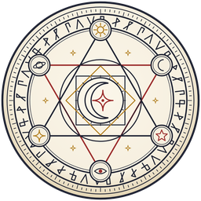
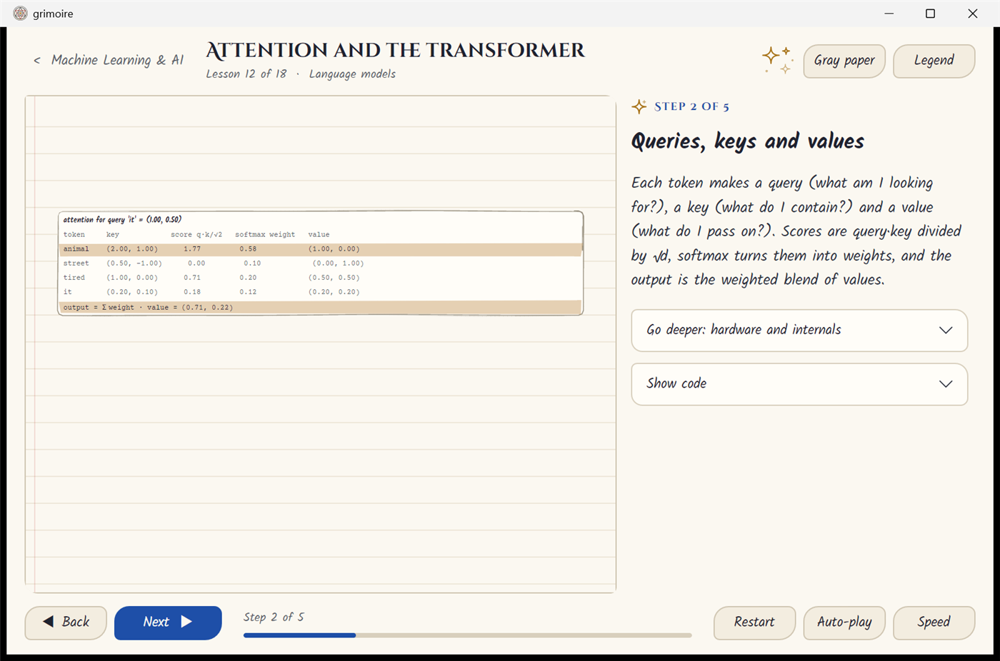
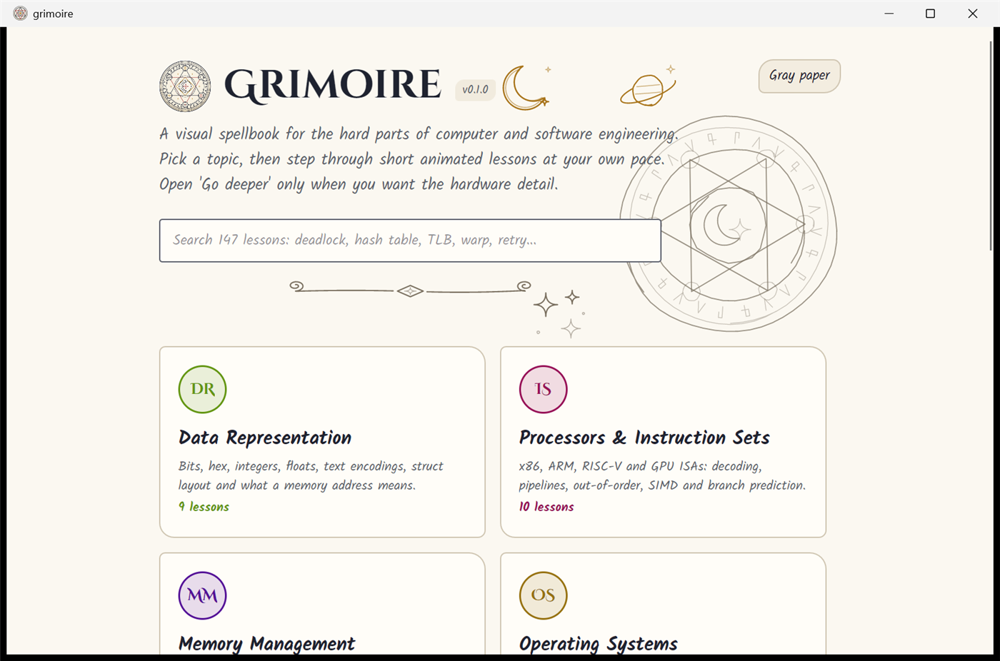
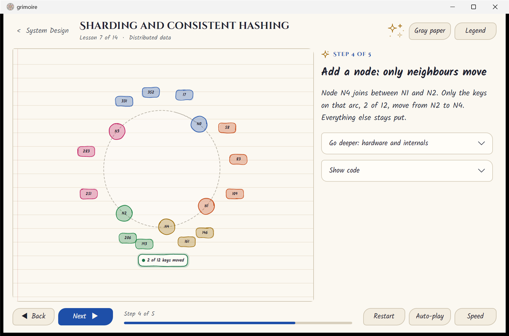

<p align="center">
  
</p>

<h1 align="center">grimoire</h1>

<p align="center">
  <b>See how computers really work, one animated step at a time.</b><br>
  A free, open-source desktop knowledge base with 147 animated lessons on the hard parts of computer and software engineering.
</p>

<p align="center">
  <a href="https://github.com/arteficent/grimoire/actions/workflows/pr.yml"></a>
  <a href="https://github.com/arteficent/grimoire/releases/latest"></a>
  <a href="LICENSE"></a>
  
  
</p>

<p align="center">
  <a href="https://arteficent.github.io/grimoire/">Website</a> ·
  <a href="https://github.com/arteficent/grimoire/releases/latest">Download</a> ·
  <a href="#build-from-source">Build</a> ·
  <a href="#writing-a-lesson">Write a lesson</a>
</p>

<picture>
  <source media="(prefers-color-scheme: dark)" srcset="docs/assets/screenshot-attention-dark.png">
  
</picture>

## What is grimoire?

Most explanations of deadlocks, page tables, GPU warps, TCP or transformers are walls of text or a single static diagram. grimoire turns each concept into a **short animated story**: you press <kbd>→</kbd> and watch threads grab locks, cache lines bounce between cores, packets cross the wire, keys move around a hash ring or values flow through a neural network. Every step comes with a one-paragraph explanation, an optional **Go deeper** note with the hardware and internals, and the **real code** with the relevant lines highlighted.

- **147 lessons, 861 animated steps, 13 tracks**, from bits and instruction sets up to distributed systems and 2026 frontier AI models.
- **Computed, not drawn**: gradient descent, k-means, convolutions, attention weights, Raft elections, grid-world values and confusion matrices are calculated by the real algorithm.
- **Runnable demos**: the 18 concurrency lessons can run the actual C# scenario, so you can watch a real deadlock happen and a watchdog detect it.
- **Searchable**: find any lesson by keyword (deadlock, TLB, warp, QUIC, saga, attention...).
- **Offline and private**: a single self-contained desktop app, no account, no telemetry.
- **Paper and ink**: lessons are sketched in handwriting and pen strokes that draw themselves onto the page, with celestial and spell doodles around. Choose **white paper with dark pens** or **gray paper with light pens**; the choice is remembered.

## What you can learn

| Track | What it covers | Lessons |
| --- | --- | ---: |
| **Data Representation** | Bits and hex, what a memory address means, integers and overflow, endianness, IEEE 754 floats, UTF-8/UTF-16, struct padding, .NET object layout | 9 |
| **Processors & Instruction Sets** | x86, ARM and RISC-V encodings, the 5-stage pipeline, out-of-order execution, SIMD, branch prediction, CPU designs, GPU ISAs | 10 |
| **Memory Management** | Stack vs heap, virtual memory and the TLB, page replacement, fragmentation, buddy allocator, garbage collection, cache locality, false sharing | 10 |
| **Operating Systems** | Context switches, system calls, CPU scheduling, priority inversion, dining philosophers, banker's algorithm | 6 |
| **Concurrency & Locks** | Lock-ordering deadlocks, sync-over-async, thread-pool starvation, lost updates, memory visibility, concurrent collections (with runnable demos) | 18 |
| **Data Structures** | Arrays vs lists, ring buffers, hash tables, balanced trees, heaps, tries, LRU caches, Bloom filters, B-trees | 9 |
| **Algorithms** | Big-O, binary search, insertion/merge/quick sort, BFS/DFS, Dijkstra, topological sort, dynamic programming | 9 |
| **GPU Computing** | SIMT and warp divergence, memory coalescing, transfers and streams, bank conflicts, occupancy, VRAM | 8 |
| **Software Design** | Coupling and cohesion, OOP, SOLID, creational/structural/behavioural patterns, clean architecture, DDD, CQRS, event sourcing, testing | 15 |
| **System Design** | REST and API styles, ACID and isolation, CAP and quorums, replication, sharding, load balancing, caching, queues, sagas, Raft, observability, a URL-shortener case study | 14 |
| **Machine Learning & AI** | Regression, classification, trees, clustering, neural networks, backprop, CNNs, RNNs, embeddings, transformers, LLM training and inference, RL, diffusion, RAG and agents, frontier models | 18 |
| **Interfaces & Protocols** | Ethernet, IP, TCP, QUIC, Wi-Fi, Bluetooth, USB and USB-C, PCIe/NVMe/CXL, HDMI/DisplayPort, UART/I2C/SPI/CAN, IoT and 5G/6G | 14 |
| **Resource Management** | Connection pools, token buckets, retry storms, cache stampedes, circuit breakers, handle leaks, queueing theory | 7 |

The full, searchable list of lessons is on the [website](https://arteficent.github.io/grimoire/#tracks).

## Download

1. Open the [latest release](https://github.com/arteficent/grimoire/releases/latest) and download `grimoire-vX.Y.Z-win-x64.zip`.
2. Optionally verify it against the `.sha256` file published next to it.
3. Unzip anywhere and run `grimoire.exe`. It is a self-contained single file, so no installer and no .NET runtime are needed.

Windows SmartScreen may warn about an unsigned app: choose **More info** then **Run anyway**. Prebuilt releases are Windows x64 only for now; on macOS and Linux, [build from source](#build-from-source).

## Using the app

1. **Pick a track** on the home screen, or type in the search box to find lessons across all tracks.
2. **Open a lesson** and step through it. The canvas animates what changed; the panel on the right explains it.
3. Expand **Go deeper** for the hardware detail and **Show code** for the code, with the lines for the current step highlighted.
4. In concurrency lessons, toggle **Run the real code** to execute the actual scenario and watch its live log.
5. At the end of a lesson, read the **key takeaway** and jump to the next lesson.

| Key | Action |
| --- | --- |
| <kbd>→</kbd> / <kbd>PgDn</kbd> | Next step |
| <kbd>←</kbd> / <kbd>PgUp</kbd> | Previous step |
| <kbd>Space</kbd> | Auto-play / pause |
| <kbd>Home</kbd> | Restart the lesson |
| <kbd>Esc</kbd> | Back to the track, then home |

**Legend** explains the ink colours (blue = active, green = done or holding, amber = waiting, red = the problem), **Speed** controls the animation pace and the **White paper / Gray paper** button switches theme.

<p align="center">
  <picture>
    <source media="(prefers-color-scheme: dark)" srcset="docs/assets/screenshot-home-dark.png">
    
  </picture>
  <picture>
    <source media="(prefers-color-scheme: dark)" srcset="docs/assets/screenshot-sharding-dark.png">
    
  </picture>
</p>

## Build from source

Prerequisite: the [.NET 10 SDK](https://dotnet.microsoft.com/download) (a newer SDK also works). grimoire runs on Windows, macOS and Linux.

```bash
git clone https://github.com/arteficent/grimoire.git
cd grimoire

dotnet run --project grimoire          # build and launch the app
dotnet test grimoire.slnx              # run the test suite
```

Create the same self-contained Windows build the release workflow produces:

```bash
dotnet publish grimoire/grimoire.csproj -c Release -r win-x64 --self-contained true \
  -p:PublishSingleFile=true -p:IncludeNativeLibrariesForSelfExtract=true -o publish/win-x64
```

Use `-r osx-arm64` or `-r linux-x64` for other platforms.

## Tech stack

| Layer | Technology |
| --- | --- |
| Runtime and language | .NET 10, C# 14 (collection expressions, raw string literals, primary constructors) |
| UI framework | [Avalonia UI](https://avaloniaui.net/) 11.3 with the Fluent theme recoloured as two paper themes |
| Fonts | [Kalam](https://fonts.google.com/specimen/Kalam) (handwriting), [Cinzel Decorative](https://fonts.google.com/specimen/Cinzel+Decorative) (titles) and [Courier Prime](https://fonts.google.com/specimen/Courier+Prime) (code), bundled under the SIL Open Font License 1.1 |
| MVVM | [CommunityToolkit.Mvvm](https://learn.microsoft.com/dotnet/communitytoolkit/mvvm/) 8.4 source generators |
| Rendering | A custom `SceneCanvas` control drawing every frame with `DrawingContext`: wobbly pen outlines, watercolour washes and handwriting that ink themselves in between steps |
| Tests | xUnit, checking the whole curriculum on every pull request |
| CI/CD | GitHub Actions: pull-request checks and a versioned release workflow |
| Website | Static GitHub Pages site in `docs/`, generated lesson catalog |

## Project structure

```text
grimoire/                    the desktop app
  Model/                     scene model: SceneState, shapes, links, StoryBuilder
  Rendering/                 SceneCanvas: concurrency view and diagram renderer, palette
  Stories/                   all lessons, one file per track; Curriculum.cs registers tracks
  Live/                      runnable concurrency scenarios behind "Run the real code"
  ViewModels/, Views/        MVVM view models and Avalonia views
  Assets/                    app icon (SVG, PNG, ICO)
tests/grimoire.Tests/        curriculum consistency tests and catalog generator
docs/                        GitHub Pages website and generated catalog.js
graphify-out/                knowledge graph of the codebase (see below)
.github/workflows/           pr.yml and release.yml
Directory.Build.props        version number and shared build settings
```

## Writing a lesson

A lesson is a short C# method. A `StoryBuilder` sets up a scene of boxes, circles, tables and arrows on a 1000 x 560 canvas, and each `Step` applies a change to a copy of the previous scene. The renderer animates the difference.

```csharp
private static Lesson Example() =>
    new StoryBuilder("XX1", "The one-sentence takeaway shown at the end.")
        .Setup(s =>
        {
            s.Box("client", "client", 40, 200, 200, 60);
            s.Box("server", "server", 700, 200, 200, 60);
        })
        .Code("""
            var response = await http.GetAsync(url);
            """)
        .Step("Send a request",
            "What the learner sees in the narrative panel.",
            "Optional 'Go deeper' detail about the hardware or internals.",
            [1],                                            // highlighted code lines
            s => s.Move("shape:client", "shape:server", "GET /", Tone.Info))
        .Lesson("Lesson title", "Section", "One-line summary for cards and search.");
```

Add the method to the track's `All()` list (or create a new track in `Stories/Curriculum.cs`), then:

1. Run the app and step through your lesson.
2. Run `dotnet test`. The tests check that every lesson has titled steps, that highlighted code lines exist, that every arrow points at a shape that exists, and that the website catalog is current.
3. Regenerate the website catalog and commit it with your lesson:

   ```powershell
   $env:GRIMOIRE_UPDATE_CATALOG = "1"; dotnet test; Remove-Item Env:GRIMOIRE_UPDATE_CATALOG   # PowerShell
   ```

   ```bash
   GRIMOIRE_UPDATE_CATALOG=1 dotnet test                                                       # bash
   ```

Helpers in `Stories/Kit.cs` cover common layouts: rows of cells, bar charts, field diagrams, plots with axes and lines, and sequence diagrams.

## Continuous integration and releases

**Pull requests** (`.github/workflows/pr.yml`) run on every PR to `main`:

1. `dotnet format --verify-no-changes`: code must be formatted according to `.editorconfig`.
2. `dotnet build -warnaserror`: the build must have no warnings.
3. `dotnet test`: every lesson is generated and checked, and `docs/catalog.js` must match the curriculum.

**Releases** (`.github/workflows/release.yml`) are started manually from the **Actions** tab on `main`. Choose which part of the version to bump (`patch`, `minor` or `major`) and the workflow will:

1. Increment `<VersionPrefix>` in `Directory.Build.props`.
2. Run the tests, then publish a self-contained single-file `win-x64` build.
3. Zip it with the README and LICENSE and compute a SHA-256 checksum.
4. Commit the version bump, tag it `vX.Y.Z`, and push.
5. Create a GitHub release with generated notes and attach the zip and checksum.

The version follows [Semantic Versioning](https://semver.org/). `Directory.Build.props` is the single source of truth: the app shows it on the home screen and stamps it into `grimoire.exe`.

> If `main` is protected, allow `github-actions[bot]` to push to it, or the version-bump commit in step 4 will be rejected.

## Website

The site at [arteficent.github.io/grimoire](https://arteficent.github.io/grimoire/) is plain HTML in `docs/`. Its lesson list is read from `docs/catalog.js`, which the tests generate from the app's own curriculum, so the site can never list a lesson the app does not have. To publish it, enable **Settings > Pages > Deploy from a branch > `main` / `docs`**.

## Codebase knowledge graph

`graphify-out/` contains a [graphify](https://pypi.org/project/graphifyy/) knowledge graph of the source code: 894 nodes and 62 labelled communities, such as the scene model, the renderers and each lesson track.

- Open `graphify-out/graph.html` in a browser to explore it visually.
- Read `graphify-out/GRAPH_REPORT.md` for the most connected nodes and the community map.
- Ask questions from a terminal: `graphify query "how does StoryBuilder build a lesson"`.
- AI assistants pick it up through `.github/copilot-instructions.md`.

After larger code changes, refresh it with `graphify update .` (code-only, no LLM needed), or `/graphify` in Copilot Chat.

## Contributing

Issues and pull requests are welcome, especially new lessons, corrections and translations of tricky concepts into clearer pictures. Please keep lessons accurate and cite primary sources in the "Go deeper" text where facts may age (versions, dates, specifications).

## License

grimoire is released under the [MIT License](LICENSE). Copyright (c) 2026 arteficent.

---

<p align="center">Made with ink and curiosity by <b>Sourabh Singh</b></p>
